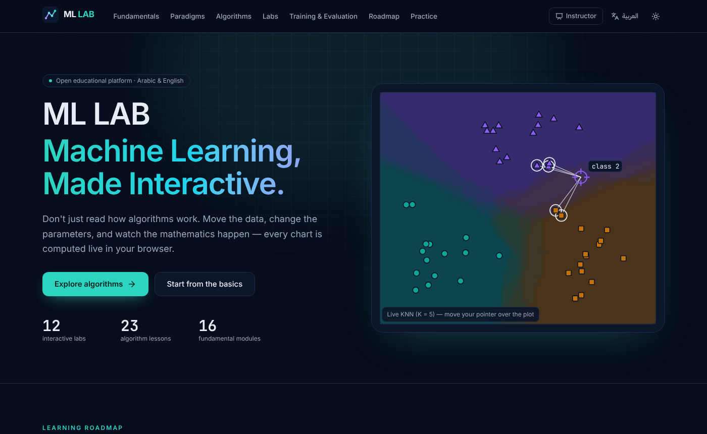
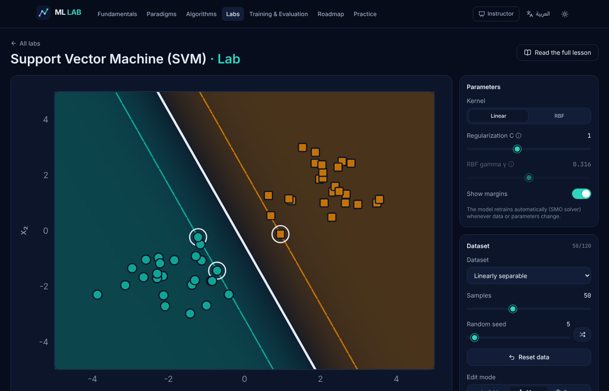
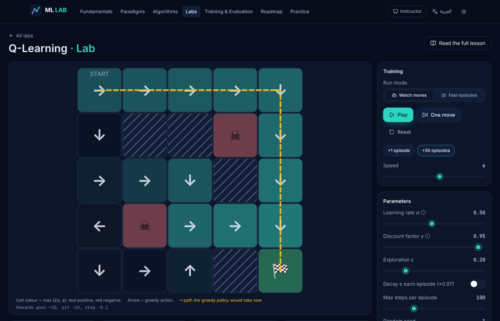
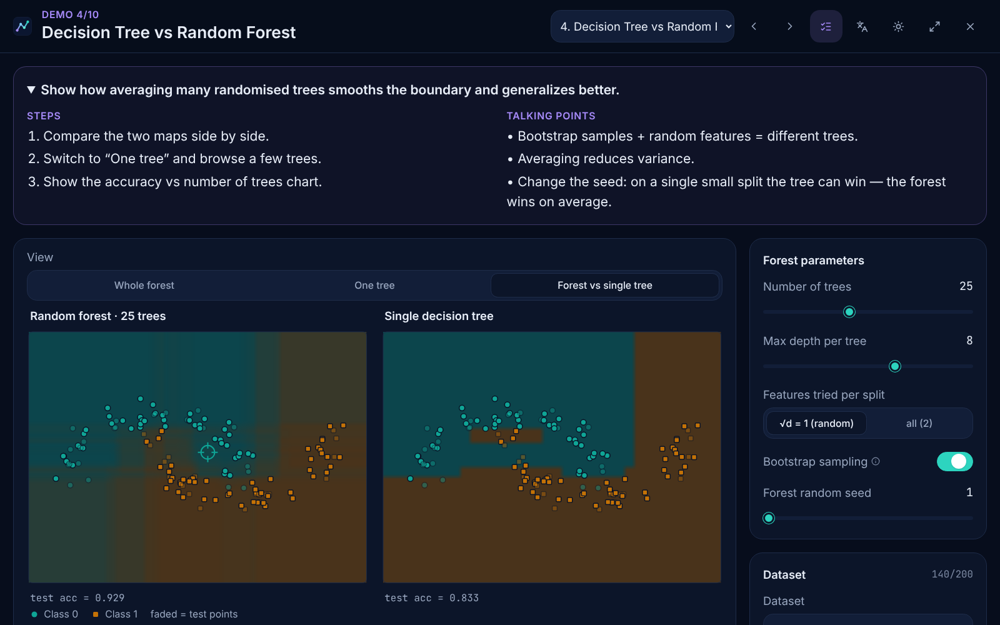
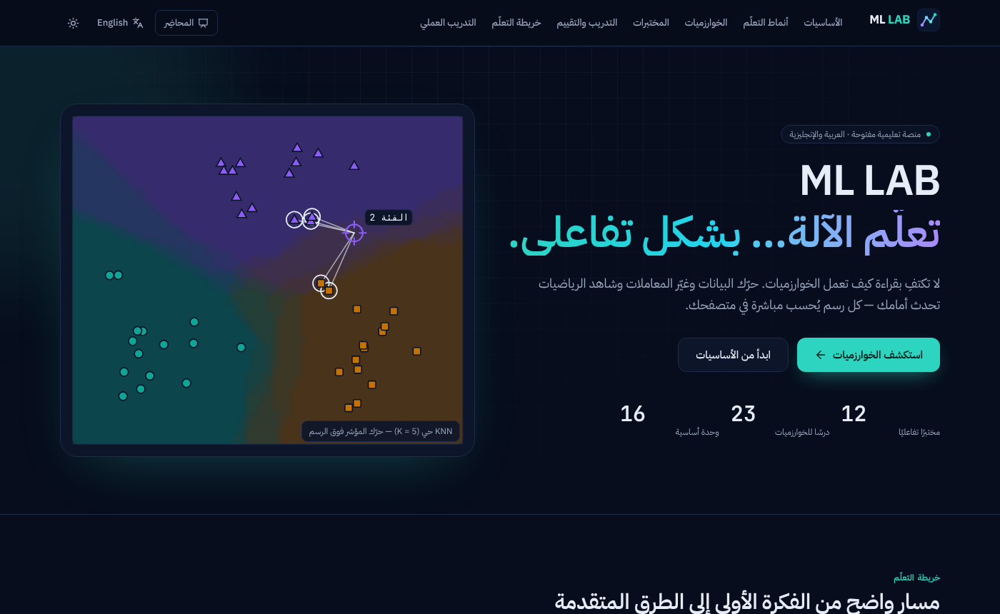

# ML LAB — Interactive Machine Learning Academy

**Machine Learning, Made Interactive.** · **تعلّم الآلة… بشكل تفاعلي.**

ML LAB is an open, bilingual (English / Arabic) educational web platform that teaches Machine Learning through **real, in‑browser simulations**. You don't just read about how an algorithm works. You move data points, change parameters and watch the mathematics respond. Every regression line, decision boundary, tree, principal component, dendrogram and policy is computed live from the current data, and the computations are covered by automated tests.



| SVM lab | Q-Learning lab |
| --- | --- |
|  |  |
| **Instructor Mode** | **Arabic (RTL)** |
|  |  |

---

## Key features

- **12 interactive laboratories** with real implementations:
  - *Supervised:* Linear Regression (gradient descent + closed form, loss surface), Logistic Regression (threshold, confusion matrix, ROC), KNN (3 metrics, feature-scaling experiment), Decision Tree (CART, Gini/entropy, tree diagram, decision path), Random Forest (bootstrap, OOB, forest vs tree), SVM (SMO solver, linear/RBF, support vectors, margins), Gaussian Naive Bayes (step-by-step Bayes table, likelihood curves).
  - *Unsupervised:* K-Means (half-step execution, k-means++ / click initialisation, elbow), PCA (2-D and 3-D, manual axis vs computed PCs, reconstruction), Hierarchical Clustering (4 linkages, draggable dendrogram cut, linkage comparison).
  - *Reinforcement:* Q-Learning Grid World (editable grid, live Bellman updates, Q-values, greedy policy) and Exploration vs Exploitation (ε-greedy multi-armed bandit, averaged ε comparison).
- **23 algorithm pages** following a standard 21-part structure: objectives, intuition, use cases, steps, maths, lab, parameters, experiments, metrics, pros, cons, common mistakes, Python (scikit-learn), quiz, related algorithms and references. Eleven of them are explanation pages (DBSCAN, GMM, association rules, Apriori, FP-Growth, t-SNE, UMAP, SARSA, DQN, policy gradients, actor-critic). They are **clearly marked as explanation pages**.
- **16 fundamentals modules** (AI vs ML vs DL, datasets, features/labels, splits, generalization, lifecycle, responsible ML…) with interactive demos.
- **5 paradigm pages** (supervised, unsupervised, reinforcement with a full RL glossary, semi-supervised, self-supervised).
- **Training & evaluation modules** with live widgets: missing values, scaling, encoding, leakage, imbalance, gradient descent, bias–variance, regularization, threshold/ROC/AUC, regression metrics, k-fold cross-validation, grid vs random search.
- **Algorithm comparison** across purpose, paradigm, data needs, assumptions, strengths, weaknesses, use cases, hyperparameters and evaluation.
- **Learning roadmap** that distinguishes interactive labs, explanation lessons and planned modules. It also has a guided beginner path and **local progress tracking** (no account needed).
- **Practice:** a quiz bank with instant feedback, generated numeric exercises with worked solutions, and **lab challenges verified by what you actually do** in the simulations.
- **Instructor Mode:** 10 classroom demos with large type, full screen, talking points and keyboard shortcuts (`Space` play/pause, `S` step, `R` reset, `←/→` demos, `F` full screen). It reuses the same lab components.
- **Bilingual and accessible:** complete EN/AR content, proper RTL layout (formulas, code and plots stay LTR), dark and light themes, keyboard-accessible controls, data-table alternative to pointer editing, shape + colour class encoding (colour-blind-checked palette), and `prefers-reduced-motion` support.

## Technology stack

| Area | Choice |
| --- | --- |
| UI | React 19, TypeScript (strict), Vite 8 |
| Styling | Tailwind CSS 4 with CSS-variable design tokens |
| Routing | React Router 7 (lazy-loaded pages and labs) |
| Maths typesetting | KaTeX |
| Icons | Lucide |
| Charts | Custom SVG + canvas components (`src/components/charts`) |
| Tests | Vitest, Testing Library, Playwright |

Charts are custom rather than D3/Recharts. The labs need things those libraries don't give directly: draggable points in data space, decision-region rasters, marching-squares contours and tree/dendrogram layouts. Writing them directly keeps the bundle small and every pixel tied to a computed value. Animations use CSS transitions instead of an animation library, so `prefers-reduced-motion` applies everywhere.

## Getting started

Requirements: **Node.js 20+** (developed with Node 22) and npm.

```bash
npm install
```

```bash
npm run dev          # http://localhost:5173
```

## Tests and build

```bash
npm run typecheck    # strict TypeScript
```

```bash
npm test             # Vitest: maths, components, content integrity
```

```bash
npm run build        # type-check + production build into dist/
```

```bash
npm run test:e2e     # Playwright (builds must exist: run `npm run build` first)
```

Playwright starts `vite preview` automatically. If you need the browsers locally, run `npx playwright install chromium` once.

## Deployment

### Netlify
The repository includes `netlify.toml` (build command, `dist` publish directory, SPA redirect and security headers).

1. In Netlify, choose **Add new site → Import an existing project** and select this repository.
2. Netlify reads `netlify.toml`: build command `npm run build`, publish directory `dist`.
3. Deploy. No environment variables or secrets are required.

Or with the CLI:

```bash
npx netlify-cli deploy --build --prod
```

### Vercel
`vercel.json` contains the SPA rewrite. Import the repository in Vercel; the Vite preset (build `npm run build`, output `dist`) works as-is.

## Repository structure

```
src/
  lib/ml/            Pure, seeded algorithm implementations (no React)
    __tests__/       Unit tests against analytical/reference results
  labs/              One component per interactive lab + registry.ts
    shared/          Lab layout, play controls, dataset panel, hooks
  components/
    charts/          Plot2D (scales, drag, heatmap, contour), LineChart, BarChart, TreeDiagram…
    evaluation/      Live widgets for the training & evaluation section
    learning/        Quiz, completion toggle, cards, fundamentals demos, hero preview
    layout/ ui/      App shell, header/footer, primitives, KaTeX renderer, code block
  content/           Bilingual educational content (algorithms, fundamentals, paradigms,
                     evaluation, roadmap, exercises, instructor demos)
  pages/             Route components
  i18n/              Language provider ([en, ar] tuples), shared vocabulary
  progress/          localStorage progress store
  config/brand.ts    Name, tagline, owner, links (edit here to re-brand)
  index.css          Design tokens (colours) for dark/light themes
e2e/                 Playwright tests
docs/                Screenshots and the extension guide
```

## Algorithm implementation notes

All implementations live in `src/lib/ml`, are deterministic for a given seed (Mulberry32 PRNG) and are tested in `src/lib/ml/__tests__`.

| Algorithm | Implementation | Verified by |
| --- | --- | --- |
| Linear regression | Batch GD on MSE with divergence detection; OLS closed form; normal equations for multiple regression | Exact line recovery, finite-difference gradient, GD → OLS convergence |
| Logistic regression | Stable sigmoid, mean log loss + L2, batch GD | ln 2 loss at w = 0, finite-difference gradient, separable data |
| KNN | Euclidean/Manhattan/Chebyshev, majority vote (tie → closest member), z-score transform | Known distances and neighbours, tie-break, regression average |
| Decision tree | CART, midpoint thresholds, Gini/entropy, min split/leaf, MDI importances | Known best split & gain, XOR, depth limits, memorisation |
| Random forest | Bootstrap + random feature subsets (sklearn fallback rule), soft voting, OOB score | Reproducibility, ~36.8 % OOB, generalization on moons |
| SVM | Dual soft-margin problem solved by SMO with maximal-violating-pair selection; stops when KKT gap < 10⁻³ | Analytic 2- and 4-point solutions, KKT conditions, C vs margin, RBF on circles |
| Gaussian NB | ML means / population variances, sklearn variance smoothing, log-sum-exp posteriors | Hand-computed posteriors, stability far from data |
| K-Means | Lloyd's algorithm as separate assignment/update steps; Forgy and k-means++ | Exact inertia, monotone inertia, convergence |
| PCA | Sample covariance + cyclic Jacobi eigendecomposition; projection & reconstruction | Eigen-reconstruction, PC1 maximises variance, exact full reconstruction |
| Hierarchical | Lance–Williams updates (single, complete, average, Ward/SciPy convention), SciPy cluster ids | Hand-computed merge heights for all linkages |
| Q-learning | Tabular Q, ε-greedy with random tie-break, terminal bootstrap = 0 | Bellman target, convergence to Q* in a corridor, optimal 8-step path |
| ε-greedy bandit | Gaussian arms, incremental sample averages, multi-run averaging | Sample means, ε = 0 / ε = 1 behaviour, ε = 0.1 beats greedy |

Datasets are **small synthetic educational datasets** generated from a seed. Each lab shows its point limit (e.g. 50 points for hierarchical clustering because it is O(n³)), so the UI stays responsive.

## Extending the platform

See **[docs/EXTENDING.md](docs/EXTENDING.md)** for a step-by-step guide to adding a new algorithm, lab, quiz or language content.

## Known limitations

- Labs run on the main thread. Workloads are bounded by point limits, so they stay responsive on ordinary laptops; Web Workers would allow larger datasets.
- Explanation-only pages (DBSCAN, GMM, association rules, Apriori, FP-Growth, t-SNE, UMAP, SARSA, DQN, policy gradients, actor-critic) and the semi-/self-supervised paradigms do not have interactive labs yet. The roadmap marks this clearly.
- CSV upload is not included. All labs use built-in synthetic datasets and point editing.
- The main JavaScript bundle (~560 kB before compression) contains all bilingual content. Labs and pages are code-split.
- Progress is stored only in the browser (no sync across devices).
- Accessibility was addressed by design (semantics, labels, keyboard alternatives, contrast-checked palette) but has not had a formal audit with assistive-technology users.

## Roadmap

Interactive labs for DBSCAN, Gaussian mixtures (EM), SARSA (as a mode of the grid world) and label propagation. Web-Worker computation, CSV import with validation, a precision–recall curve widget, more languages, and printable worksheets for instructors.

## Creator

Created by **Aseel Melebari** as an open educational project.
ML LAB is independent and is not affiliated with or endorsed by any university or institution.

## License

[MIT](LICENSE) © 2026 Aseel Sami Melebari
